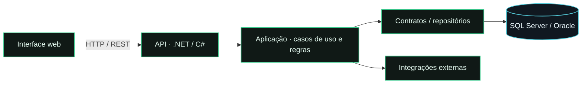
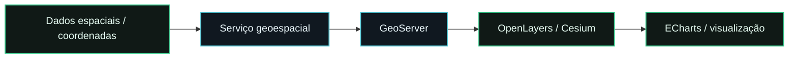

DEVELOPER LAB &nbsp;·&nbsp; BACKEND / GEO / DATA

<h1>João Vitor</h1>

<strong>Software Developer | .NET &amp; Backend</strong> 
Backend .NET/C# · desenvolvimento Full Stack · WebGIS

Antes do código, procuro entender o caminho do dado e as regras que o sistema precisa respeitar.

<pre><code>joao@developer-lab:~$ profile
focus      .NET / C# · backend
field      APIs · data · geospatial
approach   understand → model → build</code></pre>

  <a href="#projetos-em-destaque">PROJETOS</a> &nbsp;·&nbsp;
  <a href="#engenharia">ENGENHARIA</a> &nbsp;·&nbsp;
  <a href="#experiencia">EXPERIÊNCIA</a> &nbsp;·&nbsp;
  <a href="#toolbox">TOOLBOX</a> &nbsp;·&nbsp;
  <a href="#contato">CONTATO</a>

## Projetos em destaque

Projetos profissionais, acadêmicos e autorais aparecem separados. Uso capturas reais quando disponíveis; a ilustração do SIGA-Rotas é conceitual e não representa a interface do sistema.

<table>
  <tbody>
    <tr>
      <td width="170" align="center" valign="middle">
        
        
Ilustração conceitual · sem captura pública

      </td>
      <td valign="top">
        
<strong>SIGA-Rotas</strong> · Experiência profissional · Prefeitura de Santo André

        
<strong>Contexto:</strong> aplicação para planejamento e acompanhamento de rotas, com geolocalização e otimização, conforme o resumo fornecido.

        
<strong>Stack e repositório:</strong> não há repositório público disponível para verificar tecnologias ou mostrar uma captura real; por isso, não atribuo uma stack específica nem exponho detalhes de implementação.

      </td>
    </tr>
    <tr>
      <td width="170" align="center" valign="middle">
        
      </td>
      <td valign="top">
        
<strong><a href="https://github.com/jvitorsi-dev/PetClean">PetClean</a></strong> · Projeto acadêmico

        
<strong>Problema:</strong> reunir rotinas de gestão de um pet shop — clientes, pets, agendamentos, estoque e dashboards.

        
<strong>Implementação:</strong> API REST e painel web com autenticação por sessão, regras de negócio e testes.

        
<code>Java</code> <code>Spring Boot</code> <code>Spring Data JPA</code> <code>H2</code> <code>Thymeleaf</code> <code>JUnit</code>

      </td>
    </tr>
    <tr>
      <td width="170" align="center" valign="middle">
        
      </td>
      <td valign="top">
        
<strong><a href="https://github.com/jvitorsi-dev/vozes-do-oceano">Vozes do Oceano</a></strong> · Projeto autoral experimental, em desenvolvimento

        
<strong>Proposta:</strong> exploração e investigação narrativa em primeira pessoa, com decisões que influenciam os acontecimentos.

        
<strong>Implementação:</strong> sistemas de estado, anomalias contextuais e construção procedural de cenário e atmosfera.

        
<code>Godot 4.4</code> <code>GDScript</code> <code>Shaders</code>

      </td>
    </tr>
  </tbody>
</table>

## Engenharia

Os diagramas abaixo são modelos conceituais para ilustrar áreas que estudo e tecnologias que aparecem no meu trabalho. Não descrevem a arquitetura de sistemas municipais nem a implementação interna do SIGA-Rotas.

### Backend e persistência

### Fluxo geoespacial conceitual

## Experiência

### Secretaria de Tecnologia e Inovação · Prefeitura de Santo André

Desenvolvimento e manutenção de sistemas utilizados em contexto municipal, incluindo participação em projetos de geoprocessamento, WebGIS e dashboards geográficos. A experiência também envolve integração de serviços geoespaciais, manipulação de dados espaciais, bancos relacionais e resolução de problemas em sistemas legados.

Os detalhes publicados aqui ficam intencionalmente em alto nível: não compartilho código, dados ou informações internas de infraestrutura.

## Toolbox

<strong>⌘ Foco principal</strong> 
<code>C#</code> <code>.NET</code> <code>.NET Framework</code> <code>APIs REST</code> <code>SQL Server</code>

<strong>▤ Dados, web e integração</strong> 
<code>Oracle</code> <code>PL/SQL</code> <code>JavaScript</code> <code>HTML</code> <code>CSS</code> <code>Git</code> <code>GitHub</code>

<strong>⌖ Geoespacial e visualização</strong> 
<code>OpenLayers</code> <code>GeoServer</code> <code>Cesium</code> <code>ECharts</code>

As tecnologias estão agrupadas por contexto de atuação e projeto — não como uma escala uniforme de domínio.

## Interesses

Arquitetura de software, engenharia de backend, APIs, integração entre serviços, sistemas escaláveis e problemas em que regras de negócio e qualidade dos dados importam. Quero continuar aprofundando essas áreas sem perder de vista a operação e a manutenção das soluções.

## Formação

Estudante de **Análise e Desenvolvimento de Sistemas na FATEC**.

## Contato

- **GitHub:** [jvitorsi-dev](https://github.com/jvitorsi-dev)
- **LinkedIn:** [João Vitor Silva](https://www.linkedin.com/in/joao-vitor-silva-85a1a3390)
- **Email:** [jvitorsi.dev@gmail.com](mailto:jvitorsi.dev@gmail.com)
