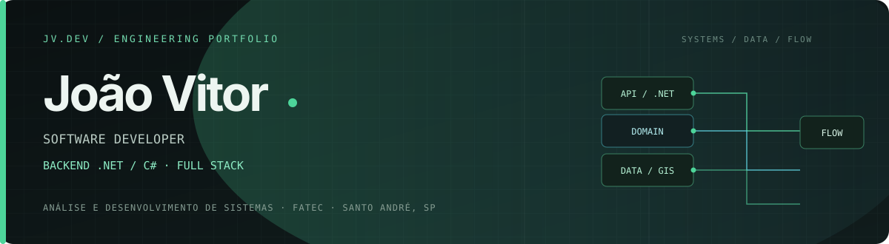
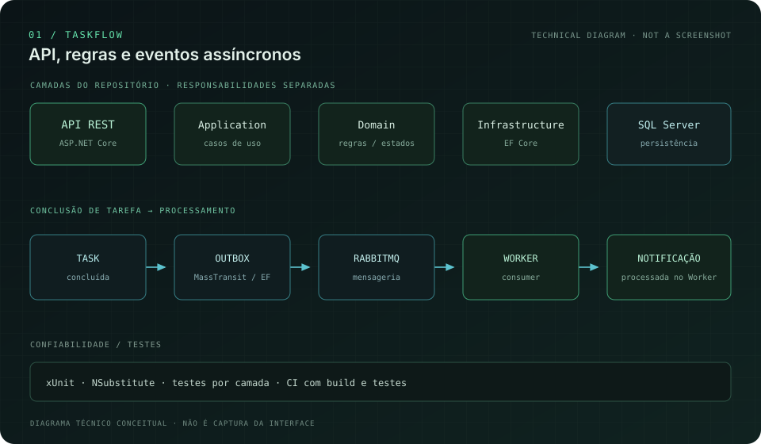
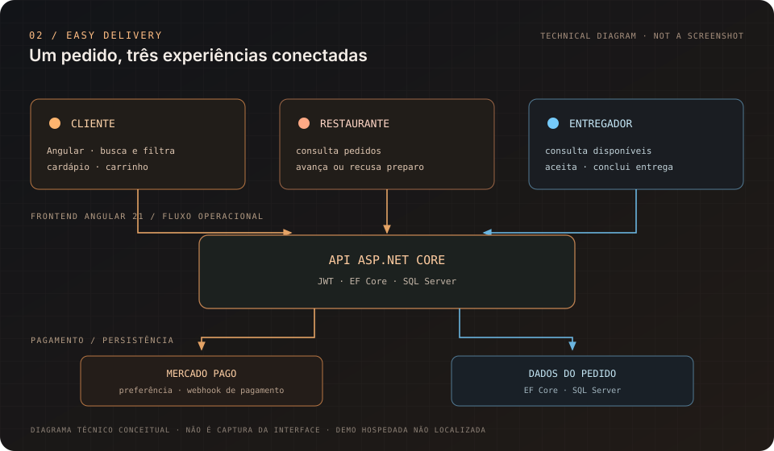
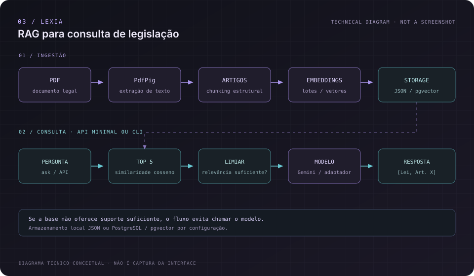

<p align="center">
  
</p>

<p align="center">
  <a href="https://jvitorsi-dev.github.io/jvitorsi-dev/"><strong>ABRIR WORKSPACE INTERATIVO ↗</strong></a><br />
  <sub>Explorer, abas, diagramas, projetos e terminal funcional no navegador</sub>
</p>

<p align="center"><code>BACKEND .NET / C#</code> &nbsp;·&nbsp; <code>FULL STACK</code> &nbsp;·&nbsp; <code>ANÁLISE E DESENVOLVIMENTO DE SISTEMAS · FATEC</code> &nbsp;·&nbsp; <code>SANTO ANDRÉ, SP</code></p>

---

## PROFILE / engenharia

Desenvolvedor com foco em **backend .NET/C#** e atuação **Full Stack**. Gosto de trabalhar em sistemas onde regras, dados e integrações precisam continuar compreensíveis enquanto evoluem. Minha experiência profissional inclui sistemas municipais, geoprocessamento, WebGIS, dashboards geográficos e bancos de dados.

> Entender o fluxo e as invariantes antes de escolher a abstração.

<details>
  <summary><strong>SESSION / TERMINAL — trecho visual estático</strong></summary>

```text
jv.dev $ whoami
João Vitor · Software Developer
jv.dev $ focus
Backend .NET/C# · Full Stack
jv.dev $ context
APIs · WebGIS · engenharia de software
```

<sub>Este bloco é apenas visual. O terminal interativo está no workspace publicado acima.</sub>
</details>

---

## PROJECTS / três recortes de engenharia

Os visuais abaixo são **diagramas técnicos conceituais** preparados para explicar cada fluxo; nenhum deles é uma captura da interface.

<table>
  <tr>
    <td width="36%" valign="top">
      
    </td>
    <td width="64%" valign="top">
      <h3>01 · TaskFlow</h3>
      <p><strong>BACKEND · ARQUITETURA EM CAMADAS · EVENTOS ASSÍNCRONOS</strong></p>
      <p>API REST para projetos, tarefas e usuários em <strong>ASP.NET Core / .NET 10</strong>, organizada em Domain, Application, Infrastructure, API e Tests.</p>
      <p><strong>PROBLEMA</strong><br />Modelar projetos e tarefas com regras e transições claras sem concentrar operações e persistência na entrada HTTP.</p>
      <p><strong>ABORDAGEM</strong><br />Separação de responsabilidades, persistência SQL Server e processamento de conclusão de tarefa fora do ciclo da requisição.</p>
      <ul>
        <li>Casos de uso e regras de domínio para projetos, tarefas e usuários.</li>
        <li>MassTransit / EF Core Outbox encaminha o evento ao RabbitMQ; o Worker processa a notificação.</li>
        <li>Testes xUnit e CI com build e testes.</li>
      </ul>
      <p><strong>STACK</strong><br /><code>C#</code> · <code>.NET 10</code> · <code>ASP.NET Core</code> · <code>EF Core</code> · <code>SQL Server</code> · <code>MassTransit</code> · <code>RabbitMQ</code> · <code>xUnit</code></p>
      <p><a href="https://github.com/jvitorsi-dev/TaskFlow"><strong>ABRIR REPOSITÓRIO ↗</strong></a><br /><sub>O branch público contém API e Worker; não localizei frontend Angular nem capturas de interface.</sub></p>
    </td>
  </tr>
  <tr>
    <td width="36%" valign="top">
      
      <p align="center"><sub>O repositório também publica a logomarca; ela não é uma captura do produto.</sub></p>
    </td>
    <td width="64%" valign="top">
      <h3>02 · Easy Delivery</h3>
      <p><strong>FULL STACK · PEDIDOS E ENTREGAS</strong></p>
      <p>Sistema de pedidos com frontend <strong>Angular 21</strong> e API <strong>ASP.NET Core / .NET 10</strong>, com experiências para clientes, restaurantes e entregadores.</p>
      <p><strong>PROBLEMA</strong><br />Conectar descoberta de restaurantes, montagem do pedido, pagamento e operação da entrega em um fluxo coerente.</p>
      <p><strong>ABORDAGEM</strong><br />Interfaces por perfil, API para pedidos e integração de pagamento, autenticação e persistência relacional.</p>
      <ul>
        <li>Busca e filtro de restaurantes, cardápio e carrinho para clientes.</li>
        <li>Restaurantes consultam pedidos e avançam ou recusam estados do preparo.</li>
        <li>Entregadores consultam pedidos disponíveis, aceitam e registram a conclusão.</li>
        <li>Preferências e notificações webhook do Mercado Pago; JWT, EF Core e SQL Server.</li>
      </ul>
      <p><strong>STACK</strong><br /><code>Angular 21</code> · <code>TypeScript</code> · <code>C#</code> · <code>.NET 10</code> · <code>SQL Server</code> · <code>Mercado Pago</code> · <code>xUnit</code></p>
      <p><a href="https://github.com/jvitorsi-dev/EasyDelivery"><strong>ABRIR REPOSITÓRIO ↗</strong></a><br /><sub>Não localizei demo hospedada; o workflow de CD simula a etapa de deploy.</sub></p>
    </td>
  </tr>
  <tr>
    <td width="36%" valign="top">
      
    </td>
    <td width="64%" valign="top">
      <h3>03 · LexIA</h3>
      <p><strong>IA APLICADA · RAG PARA LEGISLAÇÃO · PROTÓTIPO BACKEND</strong></p>
      <p>Assistente experimental para consultas sobre legislação, com recuperação de trechos relevantes e respostas orientadas por contexto e referências à lei e ao artigo.</p>
      <p><strong>PROBLEMA</strong><br />Encontrar passagens úteis em documentos legais e evitar responder quando a base indexada não oferece suporte suficiente.</p>
      <p><strong>ABORDAGEM</strong><br />PdfPig extrai texto; o conteúdo é dividido por artigo, vetorizado e recuperado por similaridade antes da chamada ao modelo.</p>
      <ul>
        <li>Busca os cinco trechos mais similares e aplica um limiar de relevância.</li>
        <li>Prompt orienta a responder com referências <code>[Lei, Art. X]</code> e sem completar lacunas fora do contexto recuperado.</li>
        <li>API Minimal e CLI; armazenamento JSON local ou PostgreSQL / pgvector por configuração.</li>
      </ul>
      <p><strong>STACK</strong><br /><code>C#</code> · <code>.NET 8</code> · <code>PdfPig</code> · <code>Microsoft.Extensions.AI</code> · <code>Gemini</code> · <code>PostgreSQL</code> · <code>pgvector</code> · <code>xUnit</code></p>
      <p><a href="https://github.com/jvitorsi-dev/lexia"><strong>ABRIR REPOSITÓRIO ↗</strong></a><br /><sub>Frontend, streaming, busca híbrida, avaliações e deploy aparecem como próximos passos, não como entregas verificadas.</sub></p>
    </td>
  </tr>
</table>

---

## FIELD NOTES / experiência

**Secretaria de Tecnologia e Inovação · Prefeitura de Santo André** — desenvolvimento e manutenção de sistemas utilizados em contexto municipal, com atuação em geoprocessamento, WebGIS, dashboards geográficos, integração de serviços, bancos de dados relacionais e sistemas legados.

<sub>Descrição em alto nível; sem código, dados ou detalhes internos de infraestrutura municipal.</sub>

---

## TOOLBOX / por contexto

| Contexto | Tecnologias |
| --- | --- |
| **Backend** | C#, .NET, ASP.NET Core, .NET Framework, APIs REST |
| **Frontend** | Angular, TypeScript, JavaScript, HTML, CSS |
| **Dados** | SQL Server, Oracle, PL/SQL, PostgreSQL, pgvector |
| **Geoespacial** | OpenLayers, GeoServer, Cesium, ECharts |
| **Ferramentas e testes** | Git, GitHub, Swagger / OpenAPI, xUnit, Moq |

<sub>Agrupadas por contexto de uso — sem níveis artificiais de proficiência.</sub>

---

## CONNECT / contato

[GitHub ↗](https://github.com/jvitorsi-dev) &nbsp;·&nbsp; [LinkedIn ↗](https://www.linkedin.com/in/joao-vitor-silva-85a1a3390) &nbsp;·&nbsp; [Email ↗](mailto:jvitorsi.dev@gmail.com)
